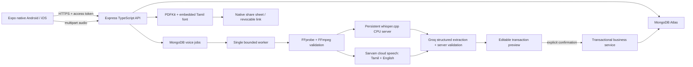

# Architecture and accounting decisions

## Financial writes

Every financial write follows `POST /api/drafts` → review → `POST /api/drafts/:id/confirm` with `confirm: true`. Draft creation requires a UUID idempotency key; reuse with different input is rejected. A confirmed draft returns its existing record on retry. No automatic optimistic mutation is used for money.

Confirmation serializes business writes through a business version counter, rechecks permissions and all entity references, recalculates decimal-safe totals, and atomically writes the financial record, stock movement, audit entry and draft state. Per-business serialization prioritizes correctness at small wholesale-business scale. A future high-volume version can use finer resource locks after testing write-skew invariants.

All queries are business-scoped, including source lots, payments, ledgers and invoices. Session revocation is checked server-side on every authenticated request. Refresh tokens rotate using an atomic hash comparison; replay revokes that session. Mobile stores only refresh credentials in SecureStore and access credentials in memory.

Money is integer paise, calculated with `BigInt` and checked before conversion to safe integer persistence. Quantities use whole configured trading units and integer gram weights. Configure `kg` or another smallest useful unit if fractional bags are needed. Rates are per configured trading unit; no implicit conversion from a spoken price is performed.

## Stock and profit

Valuation is **specific purchase lot**, selected explicitly for each sale. Cumulative proportional allocation assigns the final paise accurately. Warehouse purchases create positive movements; warehouse sales create negative movements. Direct-delivery records allocate the source purchase but create no warehouse movement.

Customer and supplier balances are derived from posted transaction records. Payments explicitly select one sale or purchase. Overpayment is rejected; advances and automatic invoice allocation are not enabled. Financial corrections reverse a posted record with a reason and audit entry, then create a new confirmed record. Dependent payments/sales must be reversed first. Issued invoices must be cancelled before a sale is reversed.

Purchase cost includes configured purchase tax, with **no assumed input-tax credit**. Gross trading profit excludes collected sales tax and deducts allocated landed cost. Net monthly profit additionally deducts separately recorded operating expenses. Do not re-enter capitalized purchase charges as operating expenses. Complete GST accounting and input-tax-credit treatment need a reviewed extension.

## Voice boundaries

Audio processing does not write financial records. The default engine loads a multilingual quantized model once in a loopback-only whisper-server. One worker processes queued jobs sequentially; FFprobe checks audio streams and duration before conversion. Model requests have a timeout; failed/cancelled audio is removed. Jobs expire after one day; conversation context expires after 30 minutes and keeps at most 30 command messages.

Groq Qwen 3.8 27B receives the original Tamil/Tanglish/English command, scoped catalog and bounded recent context, then returns a JSON intent/field/query plan. The server validates fields and references before executing predefined business-scoped queries or returning an editable proposal. Model-provided answers, code and database filters are never executed. The phrase parser has been removed; provider failures preserve manual entry rather than falling back to rules. Ambiguity requires clarification. Model accuracy still needs a representative trader corpus; three live language examples are smoke tests. See [AI setup and free-tier terms](../deployment/COMMAND_AI.md).

## Phased validation

1. Foundation: strict TypeScript, contracts, configuration, fonts, account setup and sessions.
2. Trading: contacts/products, purchase and sale confirmation, stock lots and direct delivery.
3. Voice: recording/upload states, queue, speech engine and AI extraction with server validation.
4. Financial: allocation, ledgers, operating expenses and reports.
5. Billing: draft/issue, numbered snapshots, Tamil PDF and secure sharing.
6. Intelligence: expiring context, corrections, real record queries and prices.
7. Infrastructure: reproducible Oracle/Caddy/systemd and backup templates.
8. Release: compatibility, build, automated tests, device acceptance and operational drills.

Each phase's actual acceptance status is tracked separately in [STATUS.md](../testing/STATUS.md); source implementation does not imply cloud or device acceptance.
